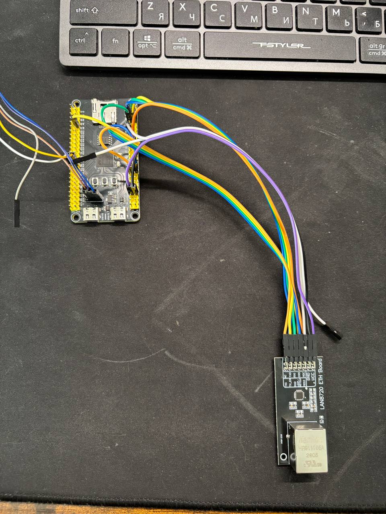
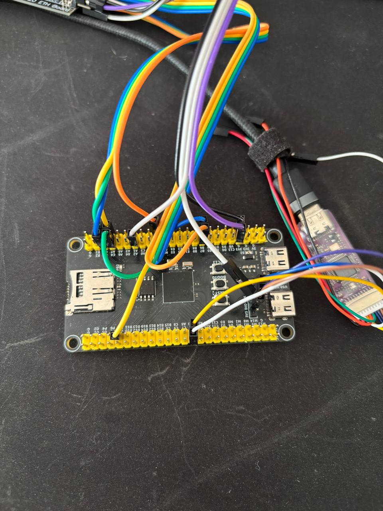
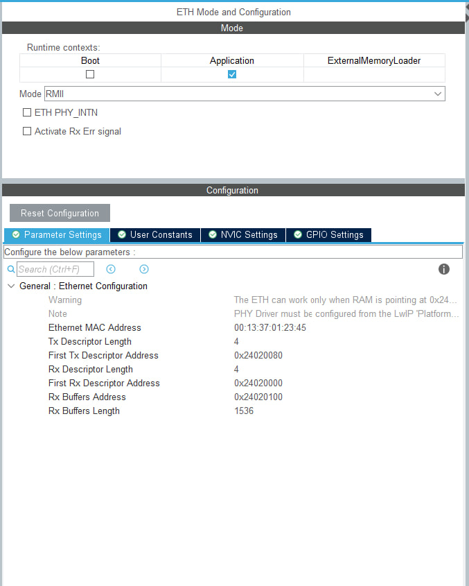
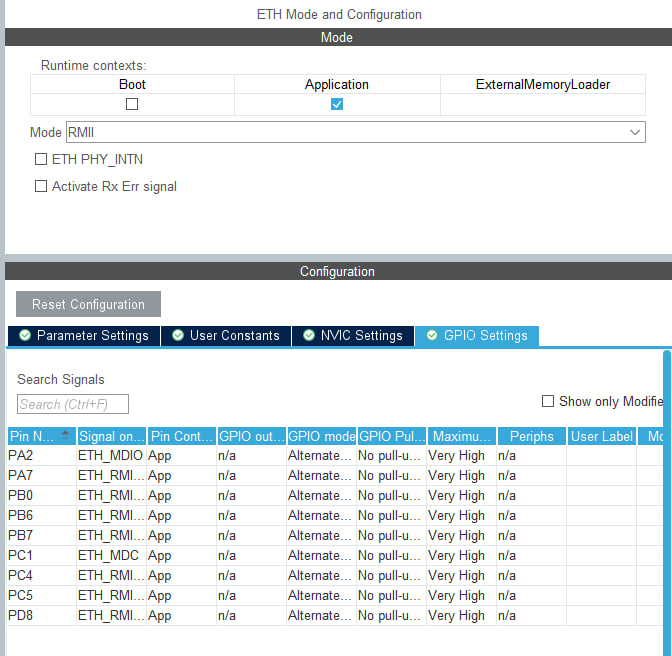
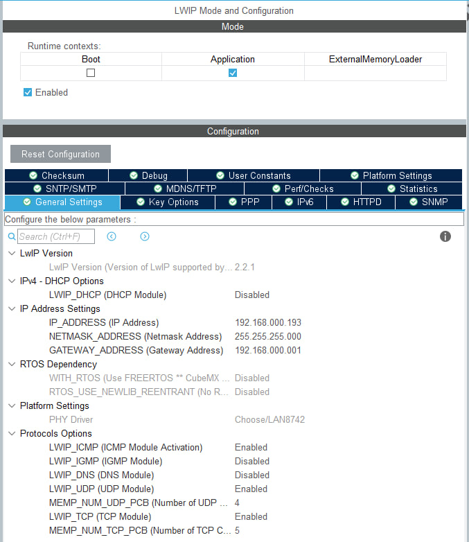
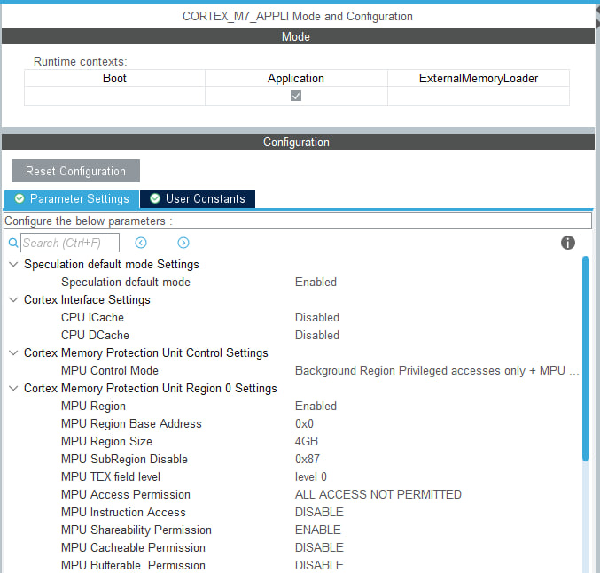
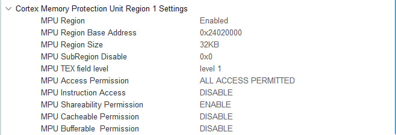
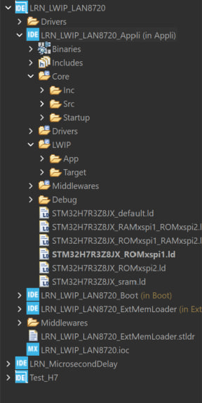
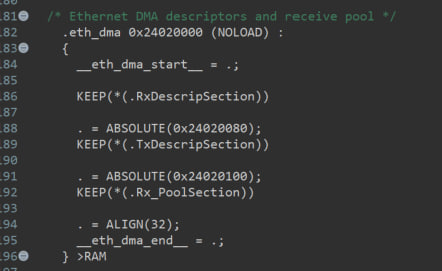
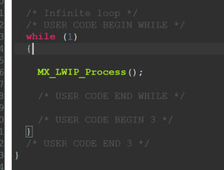

# STM32H7R3 + LAN8720: Ethernet and LwIP Setup for Ping

For the Application in the `LRN_LWIP_LAN8720` project. Boot and ExternalMemoryLoader are already configured; the Application runs from external Flash at `0x90000000`.

## 1. Wiring

| LAN8720 | STM32 |
|---|---|
| VCC | 3V3 |
| GND | GND |
| TX0 | PB0 |
| TX1 | PB7 |
| TX_EN | PD8 |
| RX0 | PC4 |
| RX1 | PC5 |
| CRS | PA7 |
| MDIO | PA2 |
| MDC | PC1 |
| nINT/REFCLK | PB6 |
| NC | Leave unconnected |

The module must supply a **50 MHz** REF_CLK signal to PB6. Leave PD6/ETH_CLK unconnected. Keep wires short and disconnect power before wiring.





## 2. ETH in CubeMX

- Context: **Application**.
- Mode: **RMII**.
- PHY_INTN and Rx Err: disabled.
- ETH REF_CLK source: **PHY**.
- GPIO: AF11, No pull, Very High; use the pins in the wiring table.

| Parameter | Value |
|---|---|
| MAC | `00:13:37:01:23:45` |
| Tx/Rx Descriptor Length | 4 / 4 |
| First Rx Descriptor Address | `0x24020000` |
| First Tx Descriptor Address | `0x24020080` |
| Rx Buffers Address | `0x24020100` |
| Rx Buffers Length | 1536 |





## 3. LwIP in CubeMX

Enable LwIP in **Application**.

| Parameter | Value |
|---|---|
| DHCP | Disabled |
| IP_ADDRESS | `192.168.000.193` |
| NETMASK_ADDRESS | `255.255.255.000` |
| GATEWAY_ADDRESS | `192.168.000.001` |
| WITH_RTOS | Disabled |
| ICMP | Enabled |
| HTTPD | Disabled |
| MEM_ALIGNMENT | 4 |
| MEM_SIZE | `5*1024` |
| LWIP_RAM_HEAP_POINTER | `0x24040000` |
| Hardware checksum | Enabled |

This project uses the **LAN8742** component, with which basic LAN8720 operation has been verified. `LAN8742_Init()` detects the PHY address automatically; no manual address setting is required.



## 4. Application MPU

**ICache and DCache: Disabled.** MPU Control Mode: Background Region Privileged accesses only (`MPU_PRIVILEGED_DEFAULT`).

| Field | Region 0 | Region 1 | Region 2 |
|---|---|---|---|
| Enabled | Yes | Yes | Yes |
| Base address | `0x00000000` | `0x24020000` | `0x90000000` |
| Size | 4 GB | 32 KB | 8 MB |
| SubRegion Disable | `0x87` | `0x00` | `0x00` |
| TEX | Level 0 | Level 1 | Level 0 |
| Access permission | No access | Full access | Full access |
| Instruction access | Disable | Disable | Enable |
| Shareable | Enable | Enable | Enable |
| Cacheable | Disable | Disable | Enable |
| Bufferable | Disable | Disable | Enable |

Region 1 covers Ethernet memory as Normal non-cacheable. Region 2 allows the Application to execute from external Flash. A region's Cacheable attribute does not enable the CPU cache.





## 5. Linker Script

Under **Application → MCU GCC Linker → General**, select `STM32H7R3Z8JX_ROMxspi1.ld`. Check the selection separately for each Debug/Release configuration you use.



Set the following values in this file:

```ld
__FLASH_BEGIN = 0x90000000;
__FLASH_SIZE  = 0x00800000;
```

Inside `SECTIONS`, after `.bss`, add the following block. If `.eth_dma` already exists, replace it:

```ld
.eth_dma 0x24020000 (NOLOAD) :
{
  __eth_dma_start__ = .;
  KEEP(*(.RxDescripSection))

  . = ABSOLUTE(0x24020080);
  KEEP(*(.TxDescripSection))

  . = ABSOLUTE(0x24020100);
  KEEP(*(.Rx_PoolSection))

  . = ALIGN(32);
  __eth_dma_end__ = .;
} >RAM
```

For GCC, this block fixes the addresses of the descriptors and the RX pool.



## 6. Code and Flashing

Generate the code. In `main.c`, keep the standard MPU, HAL, GPIO, and USART initialization, followed by `MX_LWIP_Init()`. Use the following main loop:

```c
while (1)
{
    MX_LWIP_Process();
}
```



Build the Application and program it into external Flash using the previously tested loader.

## 7. Testing from Windows

### 1) Direct Connection to the PC

Connect the LAN8720 directly to the PC's Ethernet adapter.

**Win + R → `ncpa.cpl` → Ethernet → Properties → IPv4:**

| Field | Value |
|---|---|
| IP | `192.168.0.10` |
| Subnet mask | `255.255.255.0` |
| Gateway | Leave blank |
| DNS | Not required |

```powershell
ping -4 -S 192.168.0.10 192.168.0.193
```

### 2) Connection to a Router

Run in PowerShell:

```powershell
ping 192.168.0.193
```

Expect **4 replies from `192.168.0.193`** with no packet loss, for example: `Reply from 192.168.0.193: bytes=32 time=1ms TTL=255`. Response times may vary. `Destination host unreachable` and `Request timed out` indicate that the test has failed.
