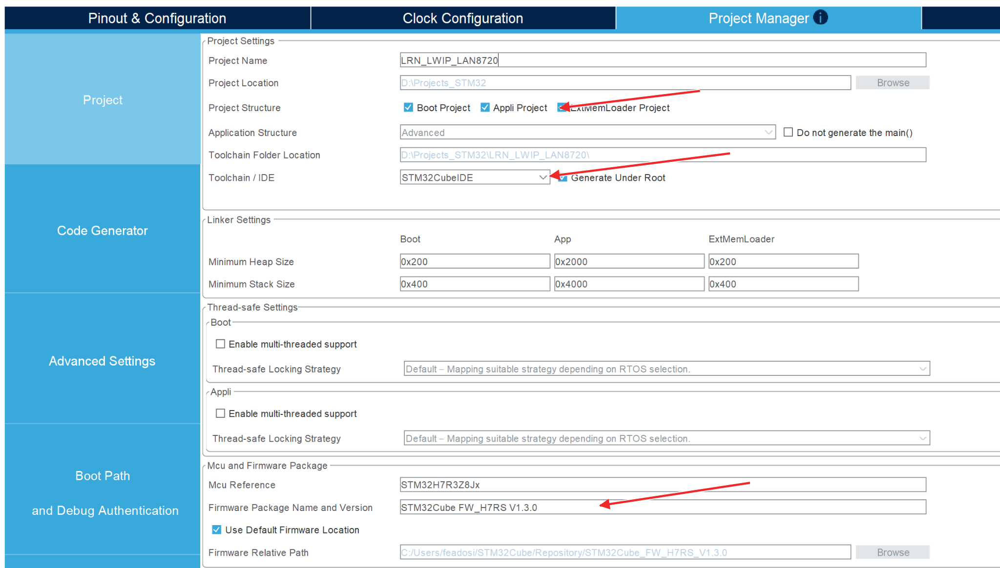
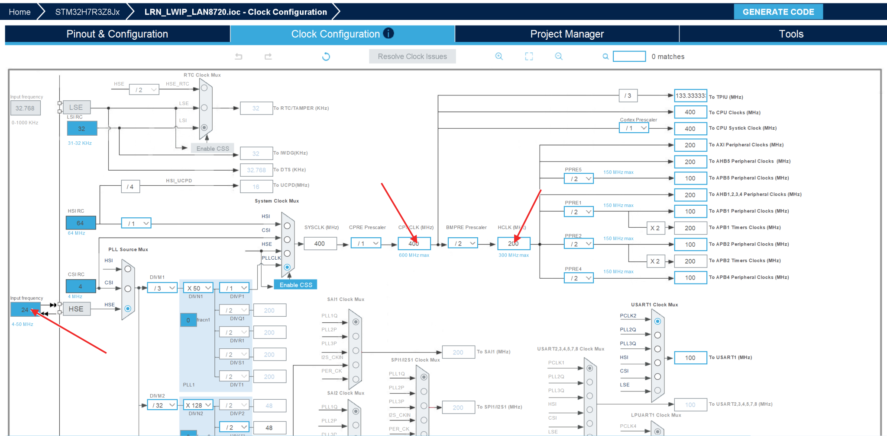
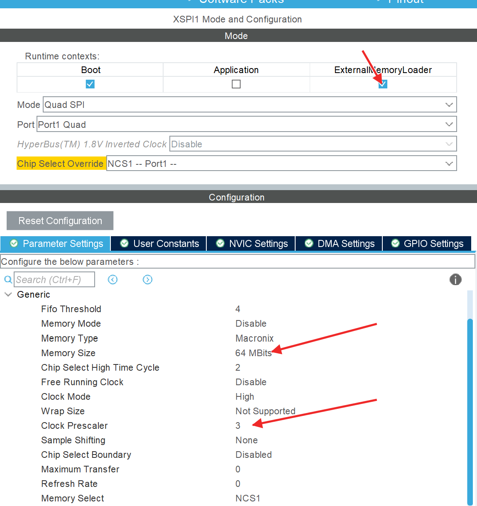
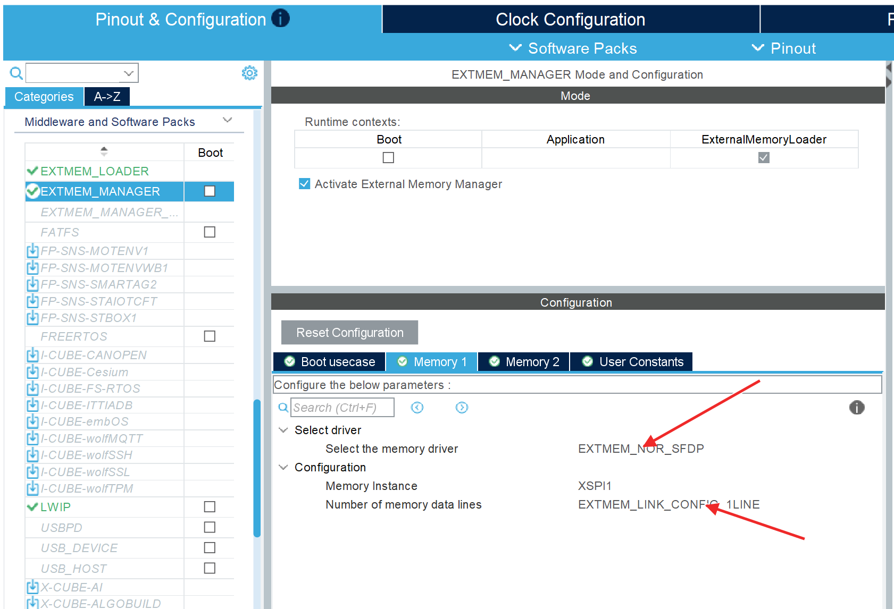
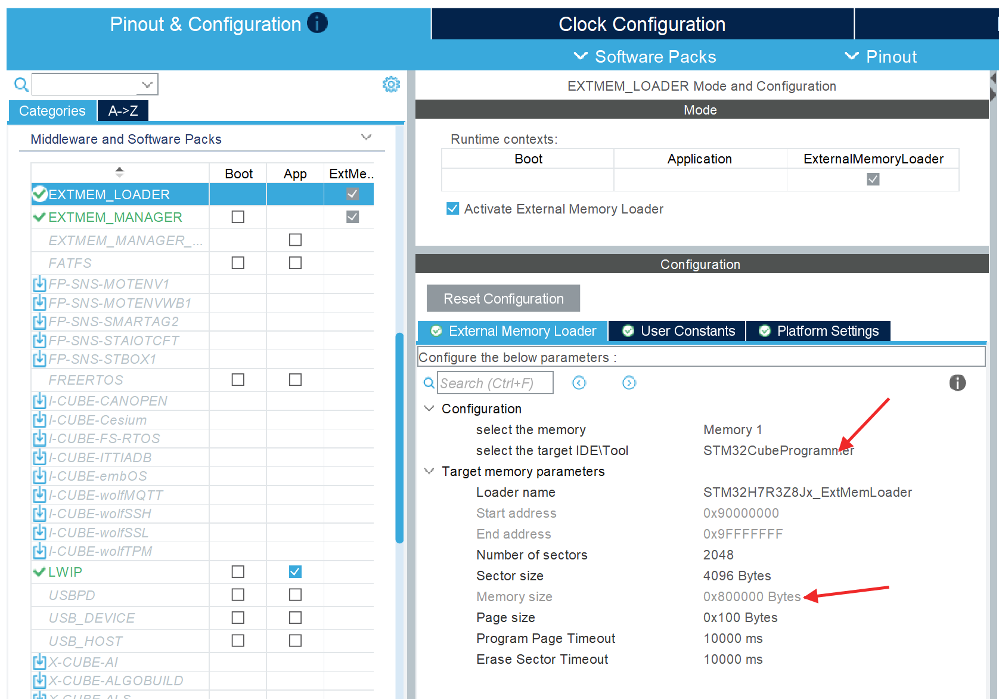
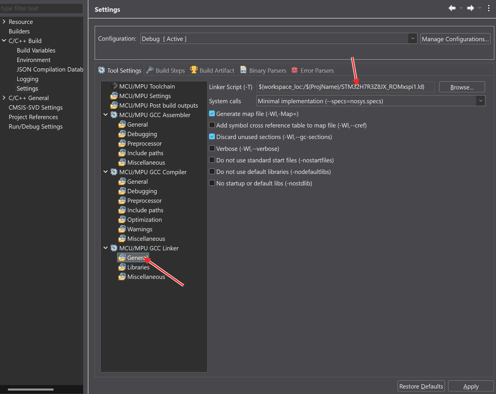
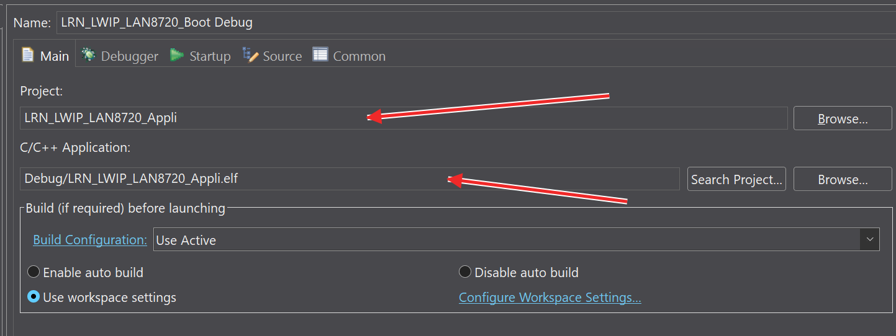
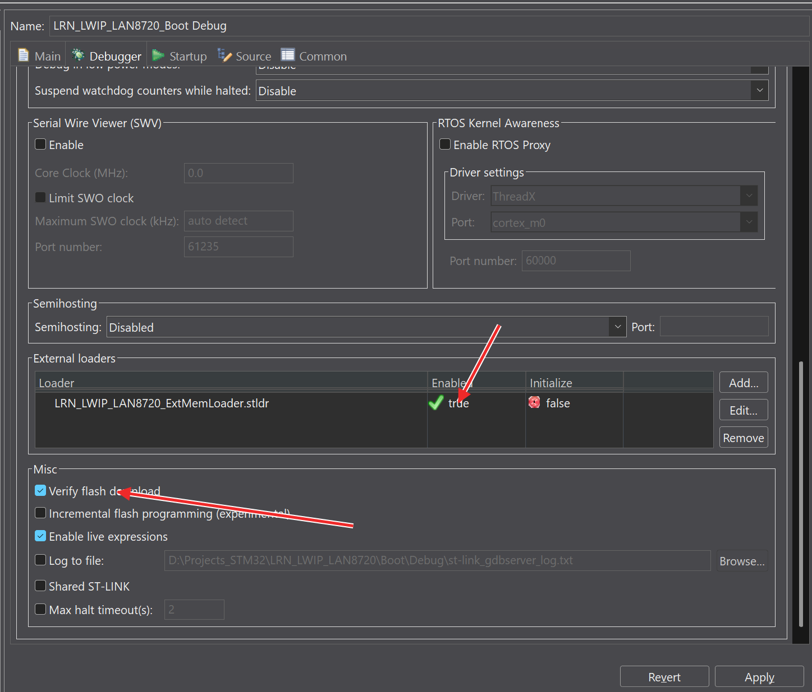
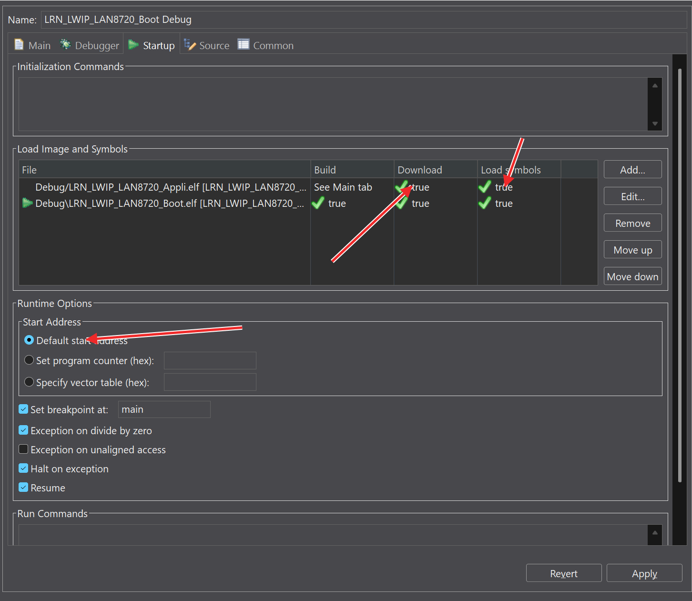

# STM32H7R3: Project Setup for Execution from External Memory

WeAct STM32H7R3Z8 with **PY25Q64HA, 8 MiB external Flash**. Application executes directly from external Flash (XIP).
Tools: **STM32CubeMX 6.18.1**, **STM32Cube FW_H7RS V1.3.0**, **STM32CubeIDE / GCC**, ST-LINK over SWD.

## 1. How it works

| Project | Purpose | Location |
|---|---|---|
| Boot | Initializes clocks and external Flash, then starts Application | Internal Flash, `0x08000000` |
| Appli | Application running from external Flash | External Flash, `0x90000000` |
| ExtMemLoader | Builds the `.stldr` used by CubeIDE to program external Flash | Runs temporarily in MCU RAM |

```text
Reset → Boot → initialize XSPI1 → memory-mapped mode → Application
```

**First program Boot, then Application using the external loader.** The `.stldr` is selected in CubeIDE; it is not flashed as a third firmware image.

## 2. CubeMX project and external memory

Open `LRN_LWIP_LAN8720.ioc`. To recreate the project, select **STM32H7R3Z8Jx**, enable **Boot / Appli / ExtMemLoader**, and choose **STM32CubeIDE** with firmware **V1.3.0**.



*1. Three projects, STM32CubeIDE and the firmware version.*

Assign **XSPI1 to Boot and ExternalMemoryLoader**.

### Clocks and XSPI1

Use the same clock settings for Boot and ExtMemLoader:

| Setting | Value |
|---|---|
| HSE | Crystal, 24 MHz |
| Voltage scaling | Scale 1 |
| PLL1 source / M / N / P | HSE / 3 / 50 / 1 |
| CPU / HCLK | 400 / 200 MHz |
| APB1/2/4/5 | 100 MHz |
| Flash latency | 5 |
| XSPI1 clock source / prescaler | HCLK / 3 → 50 MHz serial clock |



*2. HSE 24 MHz, CPU 400 MHz and HCLK 200 MHz. XSPI1 uses HCLK with division by prescaler + 1.*

Configure XSPI1 as **Quad SPI → Port1 Quad → NCS1**:

| Setting | Value |
|---|---|
| Memory type / size | Macronix / 64 Mbits (8 MiB) |
| FIFO threshold | 4 |
| Chip-select high time | 2 cycles |
| Clock mode / prescaler | High (Mode 3) / 3 |
| Sample shifting / free-running clock | None / Disabled |
| Wrap | Not supported |

“Macronix” is the controller setting used here; the installed chip is PY25Q64HA.



*3. Boot/loader assignment, memory size and prescaler.*

Pins: **PO0 → NCS1**, **PO4 → CLK**, **PP0…PP3 → IO0…IO3**. Use **AF9, push-pull, no pull, Very High speed**.

### External-memory libraries

Under **Middleware and Software Packs**, enable **EXTMEM_MANAGER** and **EXTMEM_LOADER** in **ExternalMemoryLoader**.

In **EXTMEM_MANAGER → Memory 1**, select:

- Driver: `EXTMEM_NOR_SFDP`.
- Memory instance: `XSPI1`.
- Data lines: `EXTMEM_LINK_CONFIG_1LINE` for initialization commands.



*4. NOR SFDP, XSPI1 and 1-line initialization. XSPI1 still uses the quad pin configuration above.*

Leave the manager's **Boot code generation disabled**. Boot uses the included driver `Boot/Core/Src/w25qxx_xspi.c` and header `Boot/Core/Inc/w25qxx_xspi.h`; `main.c` includes `w25qxx_xspi.h`.

The loader uses `Middlewares/ST/STM32_ExtMem_Manager` and `STM32_ExtMem_Loader`. Their sources and include paths are already configured in the supplied project.

For **EXTMEM_LOADER**, select **STM32CubeProgrammer** as the target; the resulting loader also works in CubeIDE:

| Setting | Value |
|---|---|
| Start / size | `0x90000000` / `0x800000` |
| Number of sectors / sector size | 2048 / 4096 bytes |
| Page size | 256 bytes (`0x100`) |
| Page / sector timeout | 10000 ms |



*5. Target and Flash geometry. The grey End address is misleading: the actual 8 MiB chip ends at `0x907FFFFF`.*

The PY25Q64HA SFDP fixes are **already applied**. Their code and location are documented in [Flash notes](FLASH_SFDP_NOTES.md); retain them after replacing middleware.

## 3. Select the linker scripts

In CubeIDE, right-click the relevant project → **Properties → C/C++ Build → Settings → Tool Settings**. Click **General under MCU/MPU GCC Linker**, then use **Linker Script (-T) → Browse**.

| Project | Script |
|---|---|
| Boot | `STM32H7R3Z8JX_FLASH.ld` |
| ExtMemLoader | `STM32H7R3Z8JX_extmemloader_default.ld` |
| Appli | `STM32H7R3Z8JX_ROMxspi1.ld` |



*6. Select General under the linker; the field on the right selects Application's `ROMxspi1.ld`.*

Apply and rebuild. **Debug and Release have separate settings**: Application Debug is configured correctly; Release currently uses `default.ld` and needs changing before use.

Boot occupies 64 KiB at `0x08000000`; Application uses 8 MiB at `0x90000000`. Keep the supplied Boot initialization/jump and Application MPU setup. Application inherits Boot's clocks and XSPI configuration.

## 4. Build the external loader

Build **ExtMemLoader / Debug**. If the `.stldr` is not available, copy the freshly built ELF with a new extension, from the repository root:

```powershell
Copy-Item .\ExtMemLoader\Debug\LRN_LWIP_LAN8720_ExtMemLoader.elf `
          .\LRN_LWIP_LAN8720_ExtMemLoader.stldr
```

This is a copy of the ELF, not a raw BIN conversion. Select the file in CubeIDE's **Debugger → External loaders**. If CubeIDE only lists installed loaders, place it in the **ExternalLoader** directory of the programmer bundled with that CubeIDE installation.

## 5. Program with CubeIDE

Connect ST-LINK **SWDIO, SWCLK, GND and target voltage reference**. Connect **NRST** when using Connect Under Reset. Power the board and select boot from internal Flash.

Open **Run → Debug Configurations → STM32 C/C++ Application**. Use ST-LINK/SWD in **Debugger**.

### First: Boot

1. Build **Boot / Debug**.
2. In **Main**, select the Boot project and `Debug/LRN_LWIP_LAN8720_Boot.elf`.
3. In **Startup → Load Image and Symbols**, enable Boot Download and disable any Application download.
4. Start Debug, check successful programming, then terminate the session.

### Then: Application

1. Build **Appli / Debug**.
2. In **Main**, select `LRN_LWIP_LAN8720_Appli` and `Debug/LRN_LWIP_LAN8720_Appli.elf`.



*7. Application project and ELF. The configuration name contains “Boot”, but Main selects Application.*

3. In **Debugger → External loaders**, add/enable `LRN_LWIP_LAN8720_ExtMemLoader.stldr`. Enable **Verify flash download**.



*8. Enabled custom loader and download verification.*

4. In **Startup**, enable Application Download and Load symbols. Add the Boot ELF and select it for startup (green arrow beside Boot). For Application-only updates, disable Boot Download; keep its symbols if needed.



*9. Existing combined configuration: both images are downloaded, and Boot is selected for startup. For the first Boot-only pass, disable Application Download; for Application-only updates, disable Boot Download.*

5. Keep **Default start address** and start through Boot after reset. Start Debug, verify programming, and **Resume** to run Application.
6. Terminate debugging and reset/power-cycle to check standalone startup.

The supplied `Boot/LRN_LWIP_LAN8720_Boot Debug.launch` is a combined configuration matching the screenshots. Select your own ST-LINK and check reset settings before using it.

## 6. If it does not start

- **External Flash download fails:** check the enabled `.stldr` and that it comes from the latest ExtMemLoader build.
- **Application fails after reset:** check `ROMxspi1.ld`, the `0x90000000` address, and startup through Boot.
- **After CubeMX regeneration:** check linker selection, SFDP fixes and USER CODE initialization before rebuilding.

## References

- [ST AN6101 — External Memory Manager and External Memory Loader](https://www.st.com/resource/en/application_note/an6101-introduction-to-external-memory-manager-and-external-memory-loader-middleware-for-boot-flash-mcu-stmicroelectronics.pdf).
- [WeAct STM32H7R3 board and examples](https://github.com/WeActStudio/WeActStudio.STM32H7R3Zx_CoreBoard).
